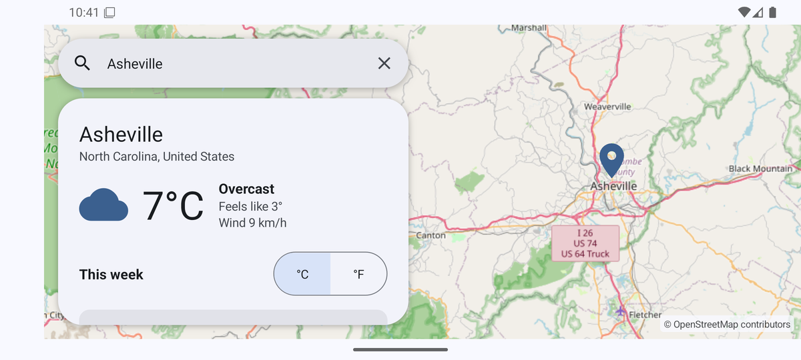
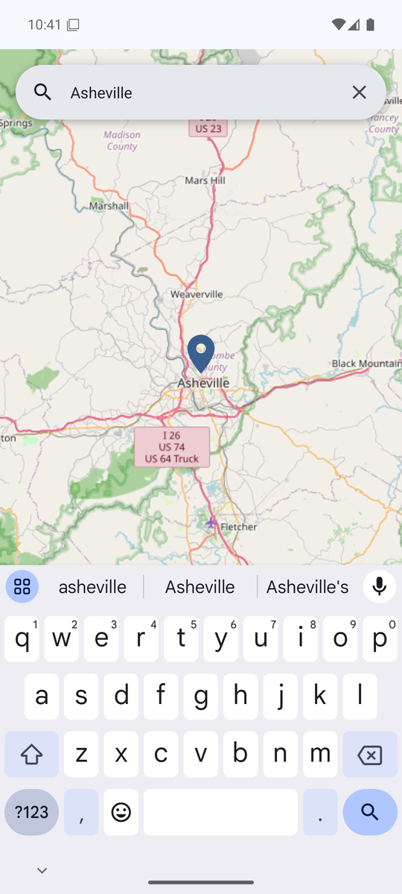

# maui-weather

A weather app in .NET MAUI. One screen: a map with a Material 3 search bar
over it. Search for a place, or press and hold on the map, and the forecast
for the week appears.

| Wide window                                                                                                 | Phone                                                                                         |
| ----------------------------------------------------------------------------------------------------------- | --------------------------------------------------------------------------------------------- |
|  |  |

It is one of four builds of the same app, alongside
[flutter-weather](https://github.com/calemccammon/flutter-weather),
[react-native-weather](https://github.com/calemccammon/react-native-weather) and
[kmp-weather](https://github.com/calemccammon/kmp-weather),
to compare the frameworks.

## What it does

- **Search** with results as you type, after a short pause; an answer to an
  older search never replaces a newer one.
- **Pick a point** by pressing and holding on the map.
- **Forecast**: current conditions, then seven days with the chance of
  precipitation and each day's range drawn against the week's.
- **Adapts to the window**: a bottom sheet on a phone, a side panel from
  840 dp wide (a phone on its side, a tablet). The map keeps the chosen
  place clear of both.
- **Celsius or Fahrenheit**, chosen on the forecast and remembered between
  launches. Until you choose, it follows the device's region.
- **Light and dark** themes from one seed colour, following the system.
- **Accessible**: each forecast block is read as one sentence by a screen
  reader, and what is loading or has failed is announced.
- **Says what went wrong**: a timeout, no connection, a refused request and a
  service in trouble each have their own message and a way to try again.

## Architecture

Clean Architecture, with one project per layer, so the compiler holds the
layers to their rule: a project can only use what it references.

| Project                        | References | What it holds                                                                                                                                                                                                                                        |
| ------------------------------ | ---------- | ---------------------------------------------------------------------------------------------------------------------------------------------------------------------------------------------------------------------------------------------------- |
| `src/MauiWeather.Domain`       | nothing    | The app's own types (`Place`, `Forecast`, `WeatherCondition`, `Units`), the repository interfaces (`IWeatherRepository` with its failure kinds, `ISettingsRepository`), and the use cases (`SearchPlaces`, `GetForecast`, `GetUnits`, `SetUnits`).    |
| `src/MauiWeather.Data`         | Domain     | Open-Meteo: the wire-shaped models (`*Dto`), their translation into domain types, and the repository implementation over `HttpClient`. Settings go into a key-value store the app supplies.                                                           |
| `src/MauiWeather.Presentation` | Domain     | What the screen shows, already rounded and worded (`*UiModel`), and the two view models that produce it. Every string is in `Resources/Strings.resx`. It knows neither the data layer nor MAUI, so it is tested without a device.                      |
| `src/MauiWeather`              | all three  | The MAUI app: the page and its views in XAML, and `MauiProgram`, the one place that says which implementation stands behind each interface.                                                                                                           |
| `tests/MauiWeather.Tests`      | the three libraries | xUnit tests for the domain, data and presentation layers.                                                                                                                                                                                    |

Each layer has its own model of the same thing, and a translation between
them:

|              | Data                           | Domain       | Presentation                                                          |
| ------------ | ------------------------------ | ------------ | --------------------------------------------------------------------- |
| Type         | `ForecastDto`                  | `Forecast`   | `ForecastUiModel`                                                     |
| A day's high | `temperature_2m_max[1] = 64.3` | `High: 64.3` | `High: "64°"`, `BarEnd: 0.75`                                         |
| Conditions   | `weather_code: 3`              | `Overcast`   | an icon and "Overcast"                                                |
| A failure    | HTTP 400, a timeout            | `Rejected`   | `Strings.FailureRejected`: "The weather service refused the request." |

State is held by two view models, `HomeViewModel` and `SearchViewModel`,
built on the MVVM Toolkit's observable properties and commands; the XAML
binds to them with compiled bindings. A request that has been overtaken
(another place selected, more text typed) is cancelled, and its answer is
ignored if it arrives anyway.

The map is [Mapsui](https://mapsui.com/) over OpenStreetMap's tiles, since
MapLibre has no maintained MAUI control. MAUI has no bottom sheet either, so
`BottomSheet` is the app's own.

## Running

.NET 10 SDK (pinned in `global.json`) with the `maui-android` workload.

```sh
dotnet build src/MauiWeather -f net10.0-android -t:Run   # build, install and start on the emulator
```

Start the emulator first with `emulator -avd Pixel_API_36`.

MAUI targets Android, iOS, macOS (Mac Catalyst) and Windows. From Linux only
Android can be built, and Android is the only one this app has been run on;
iOS and macOS need a Mac, Windows needs Windows. There is no web target and
no Linux desktop target, so unlike the other three repositories this one has
no web build and no GitHub Pages workflow.

## Checks

```sh
dotnet test tests/MauiWeather.Tests
dotnet format --verify-no-changes   # `dotnet format` fixes
```

`Directory.Build.props` turns on the .NET analyzers at their recommended
level, checks the code style rules in `.editorconfig` during the build, and
treats every warning as an error. So a normal build is also the lint run.

There are no tests of the views: MAUI has none that run without a device.
The view models are tested instead, and the views only bind to them.

`.github/workflows/ci.yml` runs on pushes to `main` and on pull requests:
format check, analyzers and tests for the three libraries, then the same for
the app and an Android debug APK uploaded as a workflow artifact.

## Data and credits

- Place search and forecasts: [Open-Meteo](https://open-meteo.com/) (no key;
  free for non-commercial use; CC BY 4.0).
- Map: tiles from [OpenStreetMap](https://www.openstreetmap.org/copyright)
  (© OpenStreetMap contributors), drawn with [Mapsui](https://mapsui.com/).
  OpenStreetMap's own tile servers are for development and light use only.
- Icons: Google's [Material Icons](https://fonts.google.com/icons) font
  (Apache License 2.0).

## Known limits

- **Android only so far.** The other platforms MAUI targets have not been
  built or run.
- **English only.** The wording is all in `Strings.resx`, and weekday names
  follow the device's language, so a second language is one more file; none
  has been written.
- **Places are not saved**: the chosen place is forgotten when the app
  closes. Only the choice of units is kept.
- **The map stays light in the dark theme.** OpenStreetMap's tiles come in
  one style.
- **The bottom sheet drags by its handle only**, between two stops. Its
  content scrolls, and does not pull the sheet up.
- **Very large text** is not given more room: the forecast's columns are a
  fixed width.

## Not built

Ideas that were considered and left out, roughly in the order they would be
worth doing:

- **Saved places** shown when the app opens.
- **Forecast for the current location**, which needs the location permission
  on each platform.
- **A second language**, to exercise the localisation set-up.
